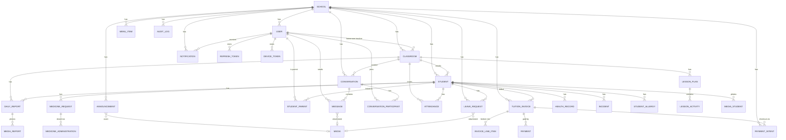
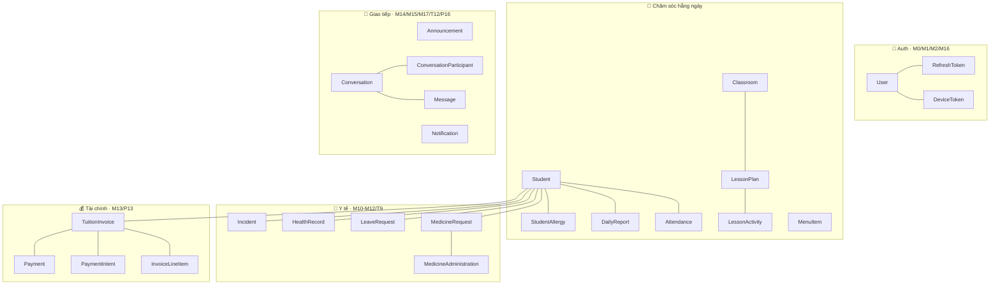

# 05 — ERD (sơ đồ) & Bản đồ DB ↔ UI/UX

> 📖 **File tham chiếu** — không chứa task có trạng thái. Dùng để: ① nhìn schema dạng sơ đồ;
> ② mỗi khi code 1 màn, mở bảng §3 để chắc UI ↔ cột DB khớp. Task thực thi nằm ở `01`–`04`.

> Hai mục tiêu: ① **vẽ lại schema** để dễ map workflow UI/UX sau này; ② chứng minh
> **database khớp 100% với mock** — mọi phần tử UI đều có chỗ lưu trong DB. Sơ đồ là
> **Mermaid** (GitHub/VSCode render trực tiếp). Schema chi tiết: [`01-database-schema.md`](./01-database-schema.md).

## 1. ERD tổng thể

## 2. ERD theo workflow (gom nhóm để map UI nhanh)

## 3. Bản đồ khớp DB ↔ UI (mỗi phần tử mock → cột DB)

> Cột "Khớp?": ✅ có cột lưu · 🆕 cần model/cột mới (đã thiết kế ở `01`) · 💻 chỉ client
> (không cần DB).

### M1 Login / M2 Register / M16 Profile

| Phần tử UI (mock) | Nguồn dữ liệu | Khớp? |
|---|---|---|
| email, password | `User.email`, `User.passwordHash` | ✅ |
| họ tên, sđt | `User.fullName`, `User.phone` | ✅ |
| thanh đo độ mạnh mật khẩu | validate `passwordSchema` | 💻 |
| ngôn ngữ VI/EN | `User.locale` | ✅ |
| dark mode toggle | colorScheme | 💻 |
| đổi mật khẩu | `POST /auth/change-password` | ✅ |

### M3a Home phụ huynh / M3b Home giáo viên

| Phần tử UI | Nguồn | Khớp? |
|---|---|---|
| "N con đang đi học" + badge trạng thái | `Attendance(date=today)` của các con | ✅ |
| con + lớp + tuổi | `Student` + `Classroom` + `dateOfBirth` | ✅ |
| khoảnh khắc hôm nay (ảnh) | `DailyReport`/`Media` mới nhất | ✅ |
| thông báo gần đây | `Announcement` | ✅ |
| N hóa đơn chưa thanh toán + tổng | `TuitionInvoice(status≠PAID)` | ✅ |
| sĩ số present/late/absent (GV) | aggregate `Attendance` | ✅ |
| "N bé chưa điểm danh", "N báo cáo thiếu" | aggregate `Attendance`/`DailyReport` | ✅ |

### M4 Children list / M5 Student detail

| Phần tử UI | Nguồn | Khớp? |
|---|---|---|
| avatar, tên, lớp, tuổi | `Student.*`, `Classroom.name`, `dateOfBirth` | ✅ |
| biệt danh "Bé Mun" | `Student.nickname` | ✅ |
| badge giới tính | `Student.gender` | ✅ |
| trạng thái hôm nay (check-in, ăn, ngủ) | `Attendance` + `DailyReport` | ✅ |
| danh sách phụ huynh + "Mẹ/Ba" | `StudentParent.relationship` | ✅ |
| tab Hình ảnh | `MediaStudent` | ✅ |

### T4 Class roster / M6 Attendance mark / M7 History

| Phần tử UI | Nguồn | Khớp? |
|---|---|---|
| KPI có mặt/muộn/vắng | aggregate `Attendance.status` | ✅ |
| bé + "PH: chị Lan" | `Student` + `StudentParent`→`User.fullName` | ✅ |
| 4 chip Có mặt/Muộn/Vắng/Phép | `AttendanceStatus` (PRESENT/LATE/ABSENT/EXCUSED) | ✅ |
| "Lưu thay đổi (5)" lưu hàng loạt | `POST /attendance/bulk` | ✅ |
| lịch tháng tô màu | `Attendance` theo range | ✅ |
| check-in time | `Attendance.checkInAt` | ✅ |

### M8 Report compose / M9 Report feed

| Phần tử UI | Nguồn | Khớp? |
|---|---|---|
| chip mood 😊😐😴😢 | `DailyReport.mood` → enum **ReportMood** | 🆕 |
| bữa ăn (text) | `DailyReport.meals` | ✅ |
| chip ngủ (Ngủ ngon/Khó ngủ/Không ngủ) | `DailyReport.napQuality` → enum **NapQuality** | 🆕 |
| hoạt động, ghi chú PH | `DailyReport.activities`, `note` | ✅ |
| ảnh báo cáo | `MediaReport` | ✅ |
| meta "Cô Hà · Lớp Mầm A" | `DailyReport.author`, `classroom` | ✅ |

### T8 Lesson plan / P14 Menu / P15 Leave

| Phần tử UI | Nguồn | Khớp? |
|---|---|---|
| "Tuần 22", chủ đề | `LessonPlan.weekNumber/year/theme` | 🆕 |
| badge thứ, khung giờ, tên, mô tả, vật liệu | `LessonActivity.*` | 🆕 |
| chip ngày T2–T6 | `MenuItem.date`/`dayOfWeek` | 🆕 |
| bữa Sáng/Trưa/Xế + giờ | `MenuItem.mealType`, `servingTime` | 🆕 |
| món + "370 kcal · …" | `MenuItem.dishName`, `description`, `calories` | 🆕 |
| cảnh báo "dị ứng tôm" | `StudentAllergy.allergen` | 🆕 |
| chọn con, loại nghỉ, từ–đến, lý do, đính kèm | `LeaveRequest.*` (+ `Media`) | 🆕 |

### M10–M12 / T9 Medicine

| Phần tử UI | Nguồn | Khớp? |
|---|---|---|
| tên thuốc, liều, lịch, từ–đến, lý do | `MedicineRequest.*` | ✅ |
| badge Chờ duyệt/Đã duyệt/Đã cho uống | `MedicineRequestStatus` | ✅ |
| timeline ai·khi nào (tạo→duyệt→cho uống) | `MedicineRequest` + `MedicineAdministration` | 🆕 |
| nút Duyệt / Từ chối (+lý do) | `status`, `rejectionReason` | 🆕 |
| ghi chú y tá | `MedicineAdministration.note` | 🆕 |

### M13 Invoices / P13 Checkout

| Phần tử UI | Nguồn | Khớp? |
|---|---|---|
| tháng, số tiền, hạn, badge | `TuitionInvoice.period/amount/dueDate/status` | ✅ |
| chi tiết (Học phí/Tiền ăn/Học liệu) | `InvoiceLineItem.label/amount/quantity` | 🆕 |
| phương thức VNPay/Bank/Momo | `PaymentProvider` | 🆕 |
| nút thanh toán → cổng | `PaymentIntent.redirectUrl/status` | 🆕 |

### M14/M15 Announcements · M17 Notifications · T12/P16 Chat

| Phần tử UI | Nguồn | Khớp? |
|---|---|---|
| ảnh bìa thông báo | `Announcement.coverMediaId`→`Media` | 🆕 |
| badge đối tượng (Lớp/Trường/PH) | `Announcement.audience` | ✅ |
| thời điểm đăng / lên lịch | `Announcement.publishedAt` | ✅ |
| icon + màu theo loại (M17) | `Notification.type` | 🆕 |
| chấm đỏ chưa đọc | `Notification.readAt = null` | 🆕 |
| deep-link khi bấm | `Notification.entityType/entityId` | 🆕 |
| inbox: tên + last msg + badge số chưa đọc | `Conversation` + `Message` + unread tính từ `lastReadAt` | 🆕 |
| bong bóng trái/phải, ảnh trong chat | `Message.senderId`, `body`, `mediaId` | 🆕 |

## 4. Kết luận khớp

- **Không có phần tử UI nào của 27 mock thiếu chỗ lưu** sau khi áp `01-database-schema.md`.
- Các phần `💻` (đo độ mạnh mật khẩu, dark mode) đúng là **client-only**, không cần DB.
- Mọi 🆕 đã có model/cột thiết kế sẵn → khi code chỉ việc migrate + map.
- Giữ nguyên khả năng cho **Web Dashboard** 🌐 (audit, line-items, lesson status, menu
  author, payment tiền mặt) — sẽ map UI/UX khi có mock web.
</content>
