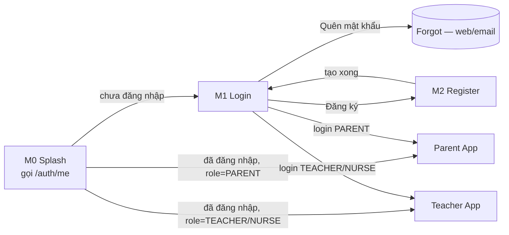
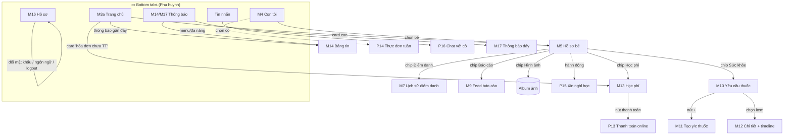
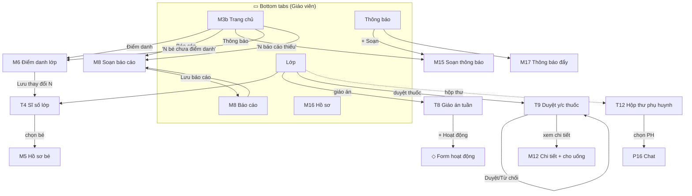
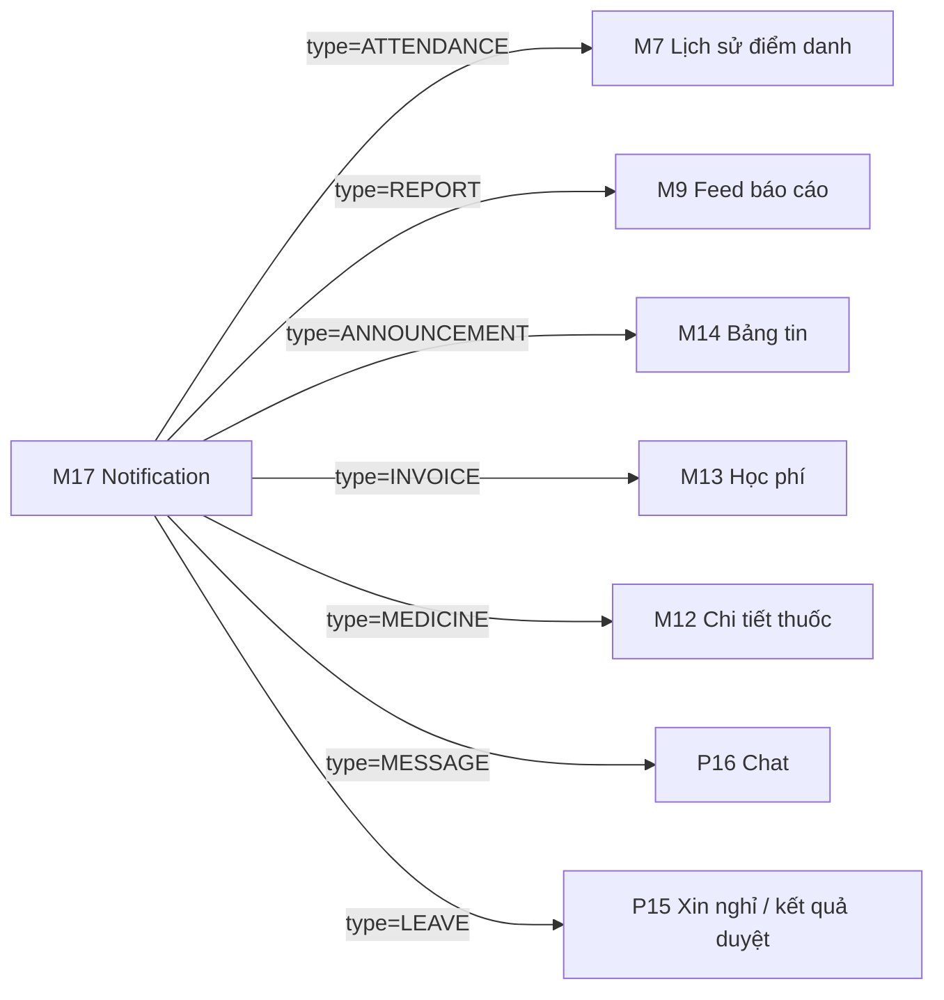
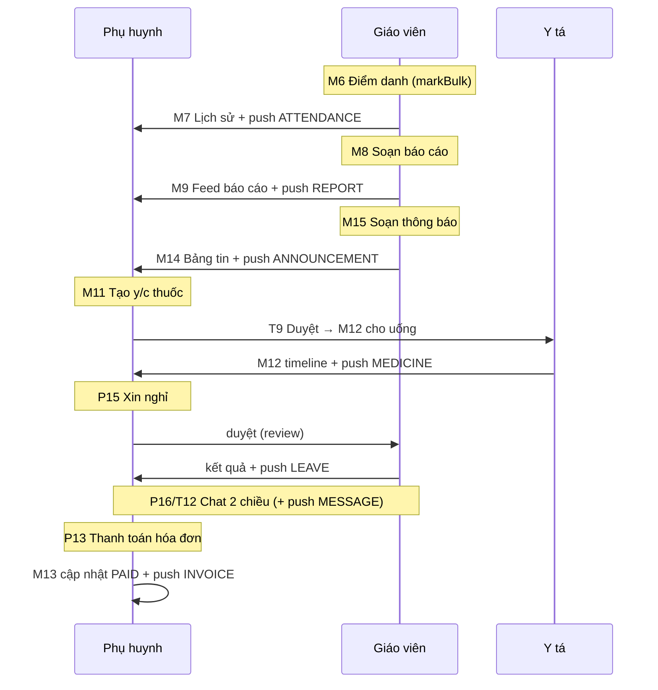

# 06 — Screen Flow (quan hệ giữa các màn hình mock)

> 📖 **File tham chiếu** — bản đồ điều hướng giữa 27 màn trong [`mocks/mobile/`](../mocks/mobile/).
> Dùng để: dựng `navigation` (MOB-0.5), biết màn nào push màn nào, và hiểu workflow PH↔GV.
> Sơ đồ **database** xem [`05-erd-and-ui-mapping.md`](./05-erd-and-ui-mapping.md). Đọc từ
> `phone-tabbar` + các nút/`chevron`/`onclick` trong từng file mock.

Ký hiệu: **▭ tab** (bottom tab) · **▢ pushed** (đẩy stack) · **◇ modal/form** · đường nét
đứt = deep-link từ notification.

---

## 1. Luồng khởi động & xác thực (chung)

---

## 2. App Phụ huynh (PARENT) — 5 tab + màn đẩy

> Ghi chú điều hướng PH:
> - `Thực đơn` (P14) và `Xin nghỉ` (P15) là tính năng PH nhưng mock đặt tab thứ 3 không
>   nhất quán (xem ⚪ trong [04-mobile-tasks §MOB-0.5](./04-mobile-tasks.md)). Đề xuất:
>   đặt **lối vào P14/P15 trong M5 (Hồ sơ bé)** hoặc một menu "Tiện ích" ở Home.
> - `M17` (push) khác `M14` (bảng tin announcement): M17 là feed thông báo cá nhân, bấm
>   vào sẽ **deep-link** sang màn nguồn (xem §4).

---

## 3. App Giáo viên / Y tá (TEACHER / NURSE) — 5 tab + màn đẩy

> Ghi chú điều hướng GV:
> - `T12 Hộp thư` (inbox của cô) và `P16 Chat` dùng **chung component thread**; chỉ khác
>   điểm vào (cô vào từ inbox, PH vào thẳng cô của lớp con).
> - `T9 Duyệt thuốc` + `M12 Chi tiết` là màn dùng chung cho **NURSE**; route NURSE tái dùng
>   stack y tế (xem MOB-0.5).

---

## 4. Deep-link từ Thông báo đẩy (M17) → màn nguồn

> `Notification.entityType` + `entityId` (xem [01 §C5](./01-database-schema.md)) quyết định
> đẩy tới màn nào — mobile map trong handler push (MOB-4).

---

## 5. Workflow tương tác chéo PH ↔ GV/Y tá (màn nào nối màn nào qua DỮ LIỆU)

> Đây là "mối quan hệ giữa các màn hình" ở góc nghiệp vụ: 1 hành động ở màn vai trò này
> tạo dữ liệu hiện lên màn vai trò kia (+ 1 push M17).

---

## 6. Bảng tra nhanh: màn → đi tới đâu

| Màn | Đi tới (nút/tab/chip) |
|-----|----------------------|
| M0 Splash | M1 hoặc Home theo role |
| M1 Login | M2, Home, Forgot |
| M3a Home PH | M5, M13, M14 |
| M4 Con tôi | M5 |
| M5 Hồ sơ bé | M7, M9, M10, M13, Album, (P14, P15) |
| M10 Thuốc | M11, M12 |
| M13 Học phí | P13 |
| M14/M17 Thông báo | deep-link §4 |
| Tin nhắn (PH) | P16 |
| M3b Home GV | M6, M8, M15 |
| Lớp (GV) | T4, T8, T9, T12 |
| T4 Sĩ số | M5, M6 |
| T9 Duyệt thuốc | M12 |
| T12 Hộp thư | P16 |
| M16 Hồ sơ | (đổi mật khẩu/ngôn ngữ/logout) |
</content>
