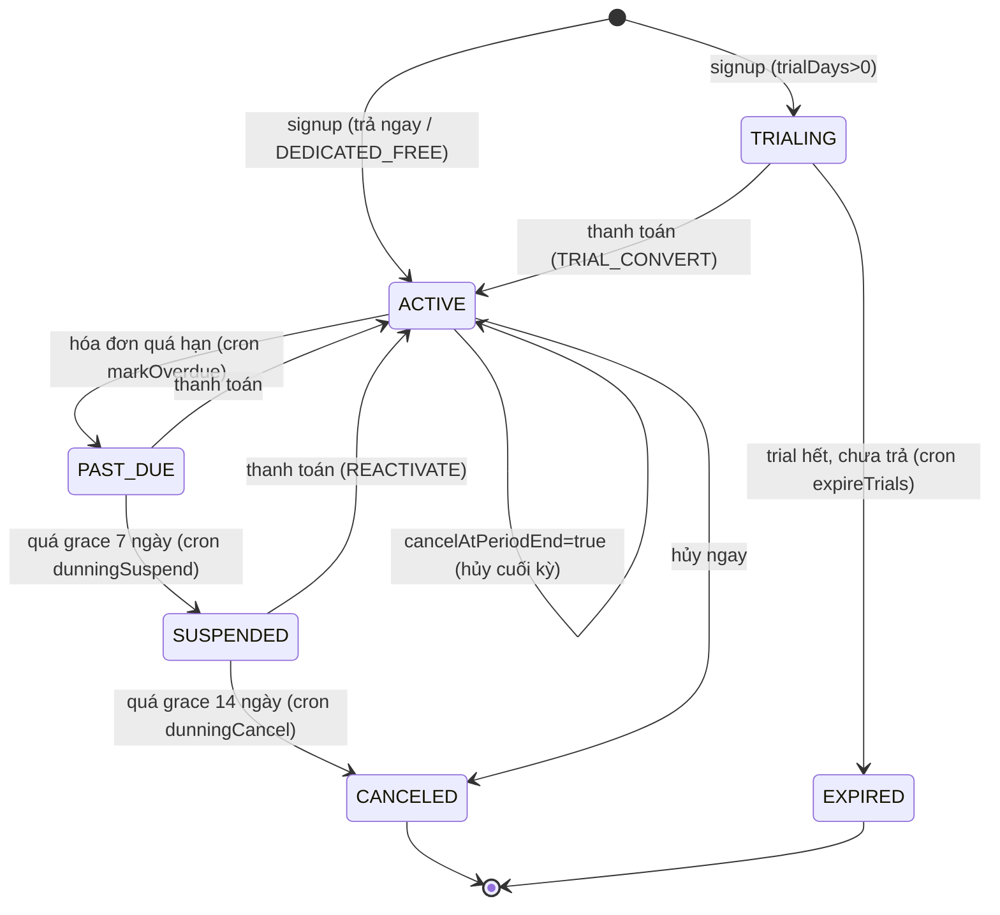

# Gói cước & Billing nền tảng

> **Lưu ý:** Đây là billing **platform → trường** (trường trả tiền thuê dịch vụ). KHÁC với **học phí** (trường → phụ huynh) thuộc Phase 1. Mọi bảng ở đây có prefix `Platform*` / `Plan*` / `Subscription*`.

## Gói cước (seed mặc định — `prisma/seed.ts`)

| code         | tier       | Giá                                 | HS / GV / Lớp / Lưu trữ | Tính năng bật                         |
| ------------ | ---------- | ----------------------------------- | ----------------------- | ------------------------------------- |
| `free`       | FREE       | 0đ — **vĩnh viễn**                  | 20 / 2 / 2 / 1GB        | —                                     |
| `starter`    | STARTER    | 490k/th · 4.9tr/năm                 | 100 / 8 / 8 / 5GB       | media_gallery                         |
| `pro`        | PRO        | 1.2tr/th · 3.24tr/quý · 12.24tr/năm | 300 / 25 / 20 / 20GB    | media_gallery, lesson_plan, analytics |
| `enterprise` | ENTERPRISE | thỏa thuận                          | ∞                       | tất cả + api_access                   |
| `dedicated`  | CUSTOM     | thỏa thuận (ẩn)                     | ∞                       | tất cả; deploy riêng                  |

> **Freemium:** `POST /public/signup` luôn gắn gói **`free` ở trạng thái ACTIVE vĩnh viễn** (`trialEndsAt=null`, `currentPeriodEnd ≈ +100 năm`) — **không qua TRIAL**. Tất cả gói seed hiện đặt `trialDays=0`; state `TRIALING` + cron `expireTrials` chỉ kích hoạt nếu cấu hình gói có `trialDays>0`.
> **Signup trả phí:** landing có thể gửi `planCode` + `billingCycle`. Backend vẫn tạo tenant Free ACTIVE trước, sau đó tạo `PlatformInvoice` OPEN metadata `{ type: "SIGNUP_UPGRADE", targetPlanId, targetPlanCode, targetBillingCycle }`. Chỉ khi platform admin bấm **Đã thu** thì subscription mới nâng sang gói đã chọn.
> **Feature key:** `media_gallery` (Album), `lesson_plan` (Giáo án), `analytics` (báo cáo nâng cao — chưa xây), `api_access`. Cờ `messaging` vẫn tồn tại nhưng **module Chat đã loại khỏi kế hoạch** — không dùng/quảng bá.
> **Quota PARENT:** không đếm bằng counter mà **giới hạn theo `STUDENTS`** (1 học sinh ~ 1 phụ huynh đại diện).

Mô hình giá **linh hoạt**: `PlanPrice` (theo chu kỳ × tiền tệ) + `PlanFeature` (bật/tắt tính năng) + `PlanLimit` (quota theo metric). Đổi giá/feature/limit không cần đổi schema.

## State machine Subscription

`Tenant.status` (cache) ánh xạ: TRIALING→TRIAL, ACTIVE→ACTIVE, PAST_DUE→PAST_DUE, SUSPENDED→SUSPENDED, CANCELED/EXPIRED→CANCELLED. Cập nhật bởi [`LifecycleService`](../kids-api/src/billing/lifecycle.service.ts).

## SubscriptionGuard — enforce theo trạng thái

| Trạng thái             | Hành vi                                                                   |
| ---------------------- | ------------------------------------------------------------------------- |
| `TRIALING` / `ACTIVE`  | Full quyền                                                                |
| `PAST_DUE`             | Full + header `X-Subscription-Status: PAST_DUE` (chỉ nhắc nợ, KHÔNG khóa) |
| `SUSPENDED`            | Chỉ đọc (GET) hoặc route `@AllowInactive` (billing)                       |
| `CANCELED` / `EXPIRED` | Chặn, trừ `@AllowInactive` (auth + billing self-service)                  |

## Feature-gating & Quota

- **Feature-gating:** `@RequireFeature('lesson_plan')`, `@RequireFeature('media_gallery')`... trên route → `SubscriptionGuard` chặn nếu gói không bật. Cờ `messaging` còn tồn tại trong seed cũ nhưng Chat đã loại khỏi kế hoạch, không dùng/quảng bá.
- **Quota:** `EntitlementService.consumeQuota(tenantId, metric)` tăng nguyên tử `UsageCounter` (UPDATE … WHERE value ≤ limit-delta). HARD vượt → `403 QUOTA_EXCEEDED`; SOFT cho vượt + ghi overage. `releaseQuota` khi xóa thực thể. Phase 1 gọi trong transaction tạo Student/Classroom...
- **Cảnh báo nâng gói:** `GET /platform/worklist` trả KPI `quota` (atRisk = số dòng >=80% / `tenants` = số trường distinct) cho tenant ACTIVE/TRIAL/PAST_DUE, tính trực tiếp từ Student/Membership(GV)/Classroom/Media (KHÔNG tính SCHOOLS — gói 1 cơ sở luôn 100%; không qua `UsageCounter` cache). Danh sách trường + cột "Hạn mức" (used/limit 4 metric) ở `GET /platform/tenants?quota=at-risk` (bấm KPI để mở) → operator chủ động tư vấn nâng gói trước khi tenant bị chặn.
- **Entitlements** = `Plan.features/limits` + override `TenantEntitlement` (cho dedicated nâng riêng). Cache ở `Subscription.entitlementsCache`.

## Hóa đơn & Thanh toán

- `BillingService.createPeriodInvoice(tenantId)` → `PlatformInvoice` OPEN từ `PlanPrice`; số hóa đơn dạng **`{SLUG}-{MÃ_GÓI}-{YYYYMMDD}-{NN}`** (vd `DEMO-PRO-20260625-01`) để dùng làm `addInfo` VietQR và đối soát thủ công.
- `BillingService.createSignupUpgradeInvoice(tenantId, planCode, billingCycle)` → hóa đơn nâng cấp sau signup. Trường dùng Free ngay; HĐ public token cho landing/success page dựng VietQR với `addInfo=invoiceNumber`. Gói không có giá VND public (>0) trả `NO_PUBLIC_PRICE` để chuyển sang tư vấn.
- `BillingService.markInvoicePaid(...)`:
  - HĐ thường: đánh dấu PAID, reactivate subscription và đẩy kỳ hiện tại như trước.
  - HĐ `SIGNUP_UPGRADE`: cập nhật `Subscription.planId/billingCycle`, set kỳ mới từ thời điểm thu tiền, clear `entitlementsCache`, `LifecycleService.syncTenantCache`, ghi `SubscriptionChange.UPGRADE`.
- Thanh toán gateway MVP: `PaymentService.createPayment` hiện chỉ nhận `provider="VNPAY"` → `PlatformPayment` PENDING + `redirectUrl` VNPay theo env (`VNPAY_PAY_URL` + `VNPAY_RETURN_URL`). Webhook `POST /platform/webhooks/vnpay` → verify chữ ký (HMAC-SHA512), **dedupe** theo `(provider,eventId)`, **idempotent** theo `(provider,gatewayRef)` → invoice PAID → reactivate + đẩy kỳ. Provider khác trả `UNSUPPORTED_PROVIDER` cho tới khi có verifier riêng.
- **Hardening chữ ký webhook (áp cho cả platform billing lẫn học phí `POST /tuition/webhooks/vnpay`):** verifier fail-closed — thiếu `VNPAY_HASH_SECRET` ở production → luôn từ chối; provider ≠ VNPAY bị chặn ngay ở route (`UNSUPPORTED_PROVIDER`). Ở dev/test khi chưa cấu hình secret thì bỏ qua verify cho tiện. VNPay **không có default URL/secret trong code**: deploy không dùng VNPay có thể để trống; khi gọi flow VNPay mà thiếu `VNPAY_PAY_URL` hoặc `VNPAY_RETURN_URL` sẽ trả `VNPAY_NOT_CONFIGURED`. Nếu production có cấu hình bất kỳ biến VNPay nào thì `config.schema` bắt đủ secret + URL, và fail-fast nếu `VNPAY_PAY_URL` còn trỏ `sandbox`.
- `billingMode`: `GATEWAY` (tự trả) · `MANUAL` (đối soát chuyển khoản) · `DEDICATED_FREE` (không thu qua gateway).
- MVP VietQR hiện **đối soát thủ công** trong Platform Console; chưa có auto đối soát ngân hàng/Casso/SePay.

## Cron jobs ([`BillingJobsService`](../kids-api/src/billing/billing-jobs.service.ts))

| Job                   | Lịch      | Việc                                  |
| --------------------- | --------- | ------------------------------------- |
| `expireTrials`        | hằng giờ  | TRIALING & hết trial → EXPIRED        |
| `markOverdueInvoices` | hằng ngày | OPEN quá hạn → OVERDUE + sub PAST_DUE |
| `dunningSuspend`      | hằng ngày | PAST_DUE > 7 ngày → SUSPENDED         |
| `dunningCancel`       | hằng ngày | SUSPENDED > 14 ngày → CANCELED        |

Logic tách khỏi `BillingCron` để test gọi trực tiếp (deterministic, truyền `now`). Mọi job idempotent + chạy `prisma.system`.

## Điểm defer cho MVP (xem plan)

- **Proration** đổi gói giữa kỳ: hiện chuyển gói ngay, áp giá mới từ kỳ kế (chưa tính proration theo ngày).
- **Auto-charge** token thẻ: tenant chủ động trả mỗi kỳ + nhắc (VNPay/Momo VN khó token hóa).
- **Hóa đơn VAT điện tử**: giữ field `tax` + line `TAX`, tích hợp sau.
