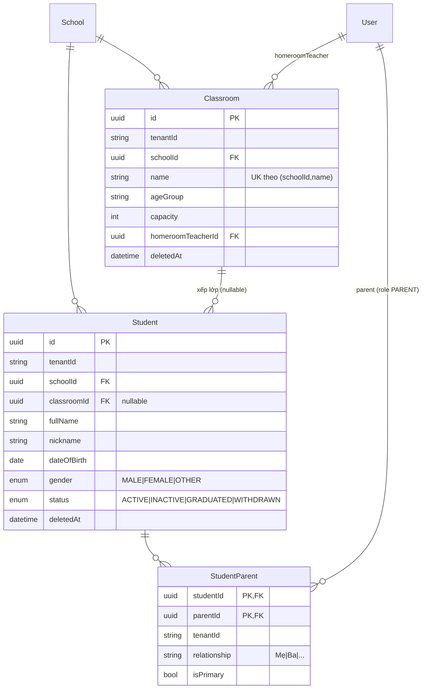
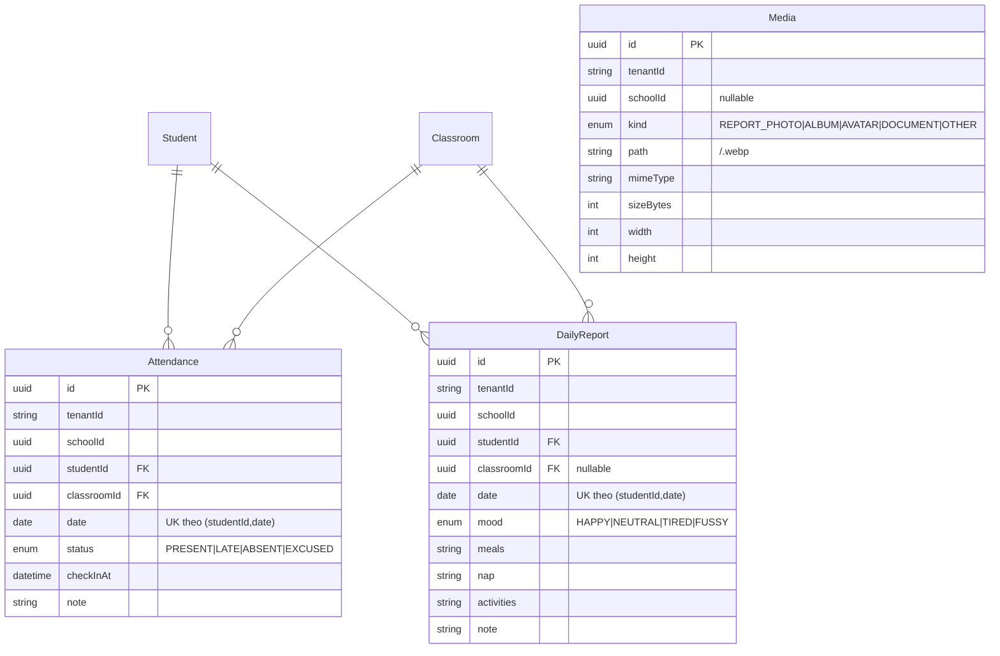

# Sơ đồ Cơ sở dữ liệu — Tầng A (Platform / SaaS)

Nguồn chân lý: [`kids-api/prisma/schema.prisma`](../kids-api/prisma/schema.prisma).
Quy ước: UUID PK · tiền tệ `Decimal(12,2)` default `VND` · soft-delete (`deletedAt`) · audit (`createdAt/updatedAt`).

> **Nguyên tắc vàng:** `tenantId` = ranh giới **BẢO MẬT** (luôn auto-filter). `schoolId` = ranh giới **NGHIỆP VỤ** (scope theo quyền). Mọi bảng domain (Phase 1) BẮT BUỘC có cả hai.

## Sơ đồ quan hệ (Mermaid ERD)

```mermaid
erDiagram
  Tenant ||--o| TenantSettings : "1-1 white-label"
  Tenant ||--o{ TenantDomain : "subdomain/custom"
  Tenant ||--o{ School : "chi nhánh (1..N)"
  Tenant ||--o{ Membership : ""
  Tenant ||--o| Subscription : "1-1 thuê bao"
  Tenant ||--o{ TenantEntitlement : "override"
  Tenant ||--o{ UsageCounter : "quota cache"

  User ||--o{ Membership : "role binding"
  School ||--o{ Membership : "scope (nullable)"
  User ||--o{ RefreshToken : ""

  Plan ||--o{ PlanPrice : "giá theo chu kỳ"
  Plan ||--o{ PlanFeature : "feature flag"
  Plan ||--o{ PlanLimit : "quota"
  Plan ||--o{ Subscription : ""

  Subscription ||--o{ SubscriptionChange : "audit/proration"
  Subscription ||--o{ PlatformInvoice : ""
  Subscription ||--o{ UsageCounter : ""
  Coupon ||--o{ Subscription : ""

  PlatformInvoice ||--o{ PlatformInvoiceLine : ""
  PlatformInvoice ||--o{ PlatformPayment : ""
  PlatformInvoice ||--o{ CreditLedger : ""

  Tenant {
    uuid id PK
    string slug UK "→ slug.kimthanhkids.vn"
    string legalName
    enum status "TRIAL|ACTIVE|PAST_DUE|SUSPENDED|CANCELLED (cache)"
    enum tenancyMode "POOL|SILO"
    enum planTier
    datetime currentPeriodEnd "cache cho guard"
    datetime trialEndsAt
    datetime deletedAt
  }
  TenantSettings {
    uuid id PK
    uuid tenantId FK,UK
    string displayName "thay 'KimThanh Kids'"
    string logoUrl
    string faviconUrl
    string primaryColor
    string emailFromName
    string locale
    string timezone
  }
  TenantDomain {
    uuid id PK
    uuid tenantId FK
    string host UK
    enum type "SUBDOMAIN|CUSTOM"
    enum status "PENDING|VERIFYING|ACTIVE|FAILED"
    bool isPrimary
    string verifyToken
  }
  School {
    uuid id PK
    uuid tenantId FK
    string name
    string code "UK theo tenant"
    bool isActive
    datetime deletedAt
  }
  User {
    uuid id PK
    enum type "PLATFORM|TENANT"
    string email "UK theo tenant; partial UK khi PLATFORM"
    string passwordHash
    string fullName
    enum platformRole "chỉ khi PLATFORM"
    uuid tenantId FK "null nếu PLATFORM"
    datetime deletedAt
  }
  Membership {
    uuid id PK
    uuid tenantId FK
    uuid userId FK
    enum role "SCHOOL_ADMIN|PRINCIPAL|TEACHER|NURSE|FINANCE|PARENT"
    uuid schoolId FK "null = toàn tenant (chuỗi)"
  }
  RefreshToken {
    uuid id PK
    uuid userId FK
    string tokenHash UK "SHA-256"
    datetime expiresAt
    datetime revokedAt
  }
  Plan {
    uuid id PK
    string code UK "starter|pro|enterprise|dedicated"
    enum tier "STARTER|PRO|ENTERPRISE|CUSTOM"
    bool isPublic
    bool isActive
    int trialDays
  }
  PlanPrice {
    uuid id PK
    uuid planId FK
    enum billingCycle "MONTHLY|QUARTERLY|ANNUAL"
    enum currency
    decimal amount
  }
  PlanFeature {
    uuid id PK
    uuid planId FK
    string featureKey "messaging|media_gallery|lesson_plan|analytics|api_access"
    bool enabled
  }
  PlanLimit {
    uuid id PK
    uuid planId FK
    enum metric "STUDENTS|TEACHERS|CLASSROOMS|SCHOOLS|STORAGE_MB|..."
    int limitValue "null = unlimited"
    enum enforcement "HARD|SOFT"
  }
  Subscription {
    uuid id PK
    uuid tenantId FK,UK
    uuid planId FK
    enum billingCycle
    enum status "TRIALING|ACTIVE|PAST_DUE|SUSPENDED|CANCELED|EXPIRED (nguồn chân lý)"
    enum billingMode "GATEWAY|MANUAL|DEDICATED_FREE"
    datetime currentPeriodStart
    datetime currentPeriodEnd
    datetime trialEndsAt
    bool cancelAtPeriodEnd
    datetime pastDueSince
    json entitlementsCache
  }
  SubscriptionChange {
    uuid id PK
    uuid subscriptionId FK
    enum type "UPGRADE|DOWNGRADE|RENEW|CANCEL|..."
    decimal prorationAmount
    datetime effectiveAt
  }
  PlatformInvoice {
    uuid id PK
    string invoiceNumber UK "PINV-YYYY-NNNNNN"
    uuid tenantId
    uuid subscriptionId FK
    enum status "DRAFT|OPEN|PAID|OVERDUE|VOID|UNCOLLECTIBLE"
    decimal total
    decimal amountPaid
    datetime dueAt
    datetime paidAt
  }
  PlatformInvoiceLine {
    uuid id PK
    uuid invoiceId FK
    enum kind "SUBSCRIPTION|PRORATION_*|OVERAGE|DISCOUNT|TAX"
    decimal amount "có thể âm"
  }
  PlatformPayment {
    uuid id PK
    uuid invoiceId FK
    enum provider "VNPAY|MOMO|BANK_TRANSFER|MANUAL"
    enum status "CREATED|PENDING|SUCCEEDED|FAILED|REFUNDED|..."
    decimal amount
    string gatewayRef "UK theo (provider,gatewayRef) — idempotent"
  }
  PlatformWebhookEvent {
    uuid id PK
    enum provider
    string eventId "UK theo (provider,eventId) — dedupe"
    bool verified
    bool processed
  }
  TenantEntitlement {
    uuid id PK
    uuid tenantId
    string featureKey "override feature"
    enum metric "override limit"
    int limitValue
    datetime expiresAt
  }
  UsageCounter {
    uuid id PK
    uuid tenantId
    enum metric
    int value "counter cache cho quota"
  }
  Coupon {
    uuid id PK
    string code UK
    enum kind "PERCENT|FIXED_AMOUNT"
    decimal amount
    enum duration "ONCE|REPEATING|FOREVER"
  }
  CreditLedger {
    uuid id PK
    uuid tenantId
    uuid invoiceId FK
    decimal amount "+ cấp / - tiêu"
  }
  AuditLog {
    uuid id PK
    uuid tenantId
    uuid actorId
    string action "tenant.suspend|invoice.void|..."
  }
```

## Nhóm bảng

1. **Identity & Tenancy:** `Tenant`, `TenantSettings` (white-label), `TenantDomain` (resolution), `School`, `User`, `Membership`, `RefreshToken`.
2. **Plan / Pricing:** `Plan`, `PlanPrice`, `PlanFeature`, `PlanLimit`.
3. **Subscription:** `Subscription` (1/tenant), `SubscriptionChange` (audit + proration).
4. **Billing nền tảng:** `PlatformInvoice`, `PlatformInvoiceLine`, `PlatformPayment`, `PlatformWebhookEvent`.
5. **Entitlement / Quota / Khuyến mãi:** `TenantEntitlement`, `UsageCounter`, `Coupon`, `CreditLedger`.
6. **Cross-cutting:** `AuditLog`.

## Index & ràng buộc đáng chú ý

- `Tenant.slug` unique; `TenantDomain.host` unique (1 host ↔ 1 tenant).
- `User`: `@@unique([tenantId, email])` + **partial unique** `email WHERE tenantId IS NULL` (platform user) — vì Postgres coi NULL là phân biệt.
- `School`: `@@unique([tenantId, code])`.
- `Subscription`: `@@unique([tenantId])` (1 thuê bao / tenant ở v1).
- `PlatformPayment`: `@@unique([provider, gatewayRef])` (idempotent webhook).
- `PlatformWebhookEvent`: `@@unique([provider, eventId])` (dedupe).
- `UsageCounter`: `@@unique([tenantId, metric])`.

---

## Tầng B — Domain (Phase 1, đang mở rộng)

> Mỗi bảng domain có `tenantId` (scalar, extension auto-filter) + `schoolId` (nghiệp vụ, scope theo `allowedSchoolIds`).

**Đã có:** `Classroom`, `Student`, `StudentParent`. Các bảng domain tiếp theo (Attendance, DailyReport, Health, Tuition, Announcement, Chat, Menu, LessonPlan, Notification…) sẽ thêm dần theo [kids-tasks/PHASE_1_TASKS.md](../kids-tasks/PHASE_1_TASKS.md), mỗi bảng đều mang `tenantId` + `schoolId`.

### C — Điểm danh & Báo cáo + Media (Phase 1)

**Media — lưu trữ nội bộ + nén:** ảnh được nén bằng `sharp` (resize cạnh ≤ `MEDIA_MAX_DIM`=1280px, **webp** quality `MEDIA_QUALITY`=72, xoá metadata) trước khi ghi xuống `MEDIA_ROOT/<tenantId>/<id>.webp` — đủ chất lượng cho phụ huynh xem, tiết kiệm dung lượng. Quota `STORAGE_MB` enforce theo tổng `sizeBytes` của tenant. Phục vụ qua `GET /api/media/:id/file` (StreamableFile, cô lập theo tenant). Xem `kids-api/src/media/`.
