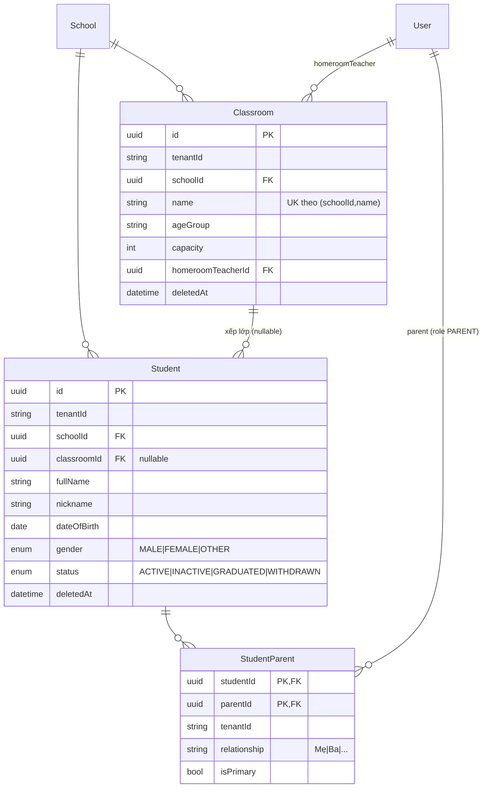
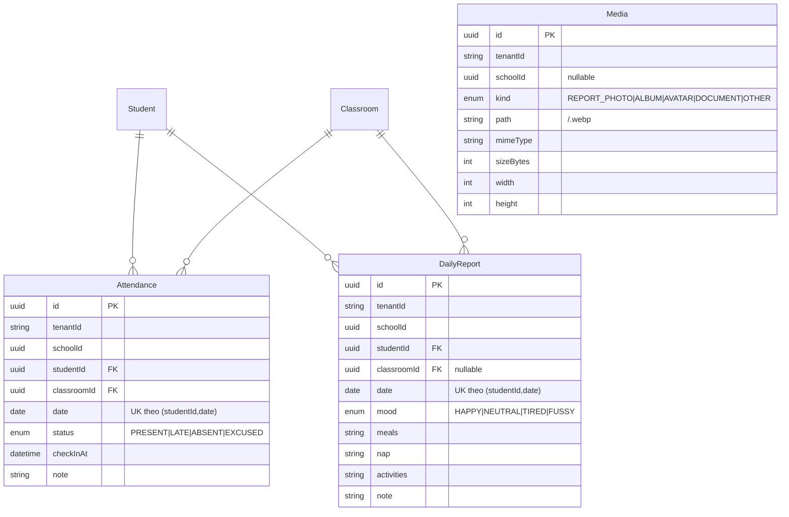
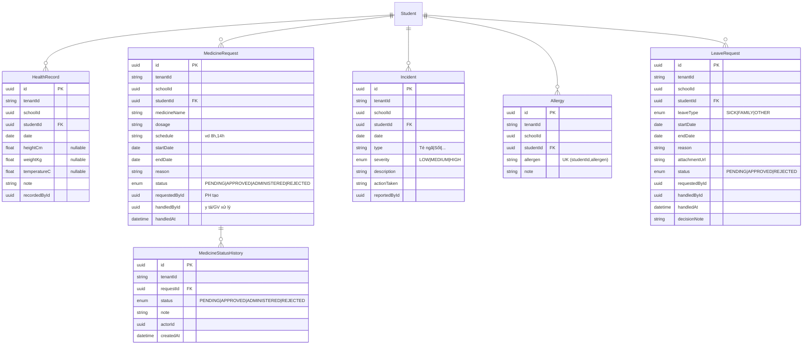
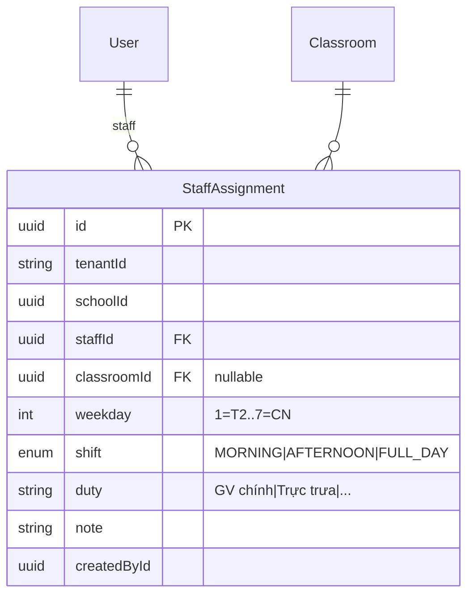
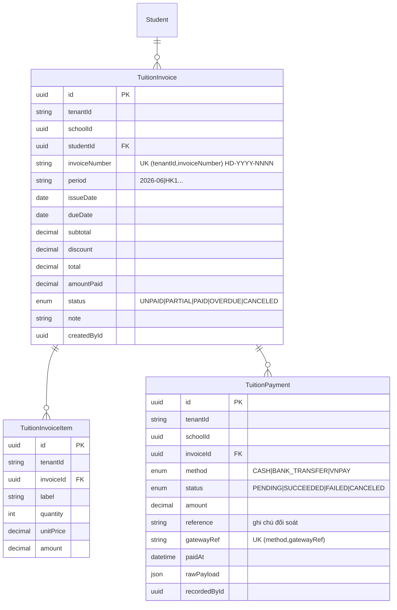
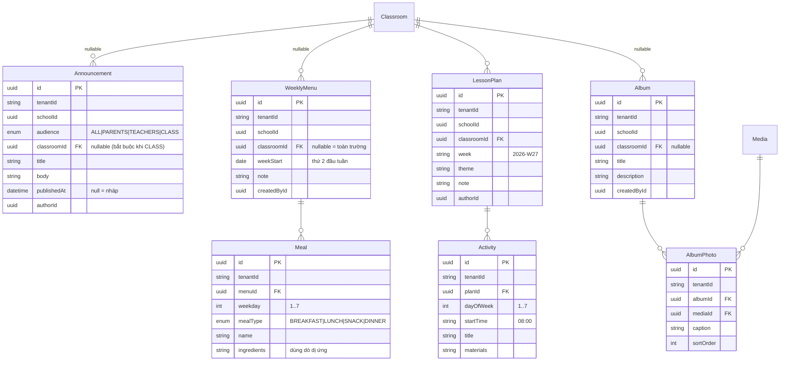
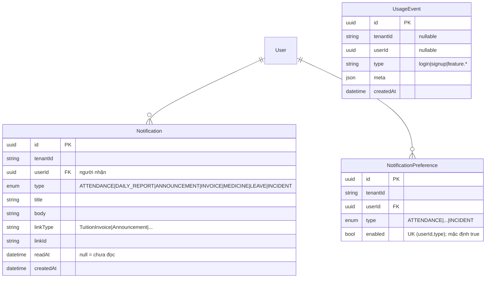

# Sơ đồ Cơ sở dữ liệu — Tầng A (Platform / SaaS)

Nguồn chân lý: [`kids-api/prisma/schema.prisma`](../kids-api/prisma/schema.prisma).
Quy ước: UUID PK · tiền tệ `Decimal(12,2)` default `VND` · soft-delete (`deletedAt`) · audit (`createdAt/updatedAt`).

> **Nguyên tắc vàng:** `tenantId` = ranh giới **BẢO MẬT** (luôn auto-filter). `schoolId` = ranh giới **NGHIỆP VỤ** (scope theo quyền). Mọi bảng domain (Phase 1) BẮT BUỘC có cả hai.

## Sơ đồ quan hệ (Mermaid ERD)

```mermaid
erDiagram
  Tenant ||--o| TenantSettings : "1-1 white-label"
  Tenant ||--o{ TenantDomain : "subdomain/custom"
  Tenant ||--o{ School : "chi nhánh (1..N)"
  Tenant ||--o{ Membership : ""
  Tenant ||--o| Subscription : "1-1 thuê bao"
  Tenant ||--o{ TenantEntitlement : "override"
  Tenant ||--o{ UsageCounter : "quota cache"

  User ||--o{ Membership : "role binding"
  School ||--o{ Membership : "scope (nullable)"
  User ||--o{ RefreshToken : ""

  Plan ||--o{ PlanPrice : "giá theo chu kỳ"
  Plan ||--o{ PlanFeature : "feature flag"
  Plan ||--o{ PlanLimit : "quota"
  Plan ||--o{ Subscription : ""

  Subscription ||--o{ SubscriptionChange : "audit/proration"
  Subscription ||--o{ PlatformInvoice : ""
  Subscription ||--o{ UsageCounter : ""
  Coupon ||--o{ Subscription : ""

  PlatformInvoice ||--o{ PlatformInvoiceLine : ""
  PlatformInvoice ||--o{ PlatformPayment : ""
  PlatformInvoice ||--o{ CreditLedger : ""

  Tenant {
    uuid id PK
    string slug UK "→ slug.kimthanhkids.vn"
    string legalName
    string taxCode UK "MST pháp nhân — 1 MST = 1 trường (chống mở trùng)"
    datetime taxVerifiedAt "đã xác minh MST với cơ quan thuế"
    enum status "TRIAL|ACTIVE|PAST_DUE|SUSPENDED|CANCELLED (cache)"
    enum tenancyMode "POOL|SILO"
    enum planTier
    datetime currentPeriodEnd "cache cho guard"
    datetime trialEndsAt
    datetime deletedAt
  }
  TenantSettings {
    uuid id PK
    uuid tenantId FK,UK
    string displayName "thay 'KimThanh Kids'"
    string logoUrl
    string faviconUrl
    string primaryColor "default #2563eb"
    string secondaryColor
    string emailFromName
    string emailFromAddr
    string supportEmail
    string locale "default vi-VN"
    string timezone "default Asia/Ho_Chi_Minh"
    string taxCode "MST — quyết toán thuế"
    string invoiceAddress
    string bankBin "VietQR napas"
    string bankAccountNumber
    string bankAccountName
  }
  TenantDomain {
    uuid id PK
    uuid tenantId FK
    string host UK
    enum type "SUBDOMAIN|CUSTOM"
    enum status "PENDING|VERIFYING|ACTIVE|FAILED"
    bool isPrimary
    string verifyToken
  }
  School {
    uuid id PK
    uuid tenantId FK
    string name
    string code "UK theo tenant"
    string moetCode "mã trường Bộ GD&ĐT (CSDL ngành)"
    bool isActive
    datetime deletedAt
  }
  User {
    uuid id PK
    enum type "PLATFORM|TENANT"
    string email "nullable — định danh email HOẶC phone; UK (tenantId,email)"
    string phone "nullable; UK (tenantId,phone) — login bằng cả hai"
    string passwordHash
    string fullName
    bool isActive "tắt → chặn đăng nhập"
    enum platformRole "chỉ khi PLATFORM"
    uuid tenantId FK "null nếu PLATFORM"
    datetime deletedAt
  }
  Membership {
    uuid id PK
    uuid tenantId FK
    uuid userId FK
    enum role "SCHOOL_ADMIN|PRINCIPAL|TEACHER|NURSE|FINANCE|PARENT"
    uuid schoolId FK "null = toàn tenant (chuỗi)"
    bool isActive
    uuid createdById
    datetime deletedAt
  }
  RefreshToken {
    uuid id PK
    uuid userId FK
    string tokenHash UK "SHA-256"
    datetime expiresAt
    datetime revokedAt
  }
  Plan {
    uuid id PK
    string code UK "free|starter|pro|enterprise|dedicated"
    enum tier "FREE|STARTER|PRO|ENTERPRISE|CUSTOM"
    bool isPublic "dedicated = false (ẩn)"
    bool isActive
    int trialDays "seed = 0 (freemium, không trial)"
  }
  PlanPrice {
    uuid id PK
    uuid planId FK
    enum billingCycle "MONTHLY|QUARTERLY|ANNUAL"
    enum currency
    decimal amount
  }
  PlanFeature {
    uuid id PK
    uuid planId FK
    string featureKey "messaging|media_gallery|lesson_plan|analytics|api_access"
    bool enabled
  }
  PlanLimit {
    uuid id PK
    uuid planId FK
    enum metric "STUDENTS|TEACHERS|CLASSROOMS|SCHOOLS|STORAGE_MB|..."
    int limitValue "null = unlimited"
    enum enforcement "HARD|SOFT"
  }
  Subscription {
    uuid id PK
    uuid tenantId FK,UK
    uuid planId FK
    enum billingCycle
    enum status "TRIALING|ACTIVE|PAST_DUE|SUSPENDED|CANCELED|EXPIRED (nguồn chân lý)"
    enum billingMode "GATEWAY|MANUAL|DEDICATED_FREE"
    datetime currentPeriodStart
    datetime currentPeriodEnd
    datetime trialEndsAt
    bool cancelAtPeriodEnd
    datetime pastDueSince
    json entitlementsCache
  }
  SubscriptionChange {
    uuid id PK
    uuid subscriptionId FK
    enum type "UPGRADE|DOWNGRADE|RENEW|CANCEL|..."
    decimal prorationAmount
    datetime effectiveAt
  }
  PlatformInvoice {
    string publicToken "UK — uuid; link công khai /hoa-don/:token"
    uuid id PK
    string invoiceNumber UK "PINV-YYYY-NNNNNN"
    uuid tenantId
    uuid subscriptionId FK
    enum status "DRAFT|OPEN|PAID|OVERDUE|VOID|UNCOLLECTIBLE"
    decimal total
    decimal amountPaid
    datetime dueAt
    datetime paidAt
  }
  PlatformInvoiceLine {
    uuid id PK
    uuid invoiceId FK
    enum kind "SUBSCRIPTION|PRORATION_*|OVERAGE|DISCOUNT|TAX"
    decimal amount "có thể âm"
  }
  PlatformPayment {
    uuid id PK
    uuid invoiceId FK
    enum provider "VNPAY|MOMO|BANK_TRANSFER|MANUAL"
    enum status "CREATED|PENDING|SUCCEEDED|FAILED|REFUNDED|..."
    decimal amount
    string gatewayRef "UK theo (provider,gatewayRef) — idempotent"
  }
  PlatformWebhookEvent {
    uuid id PK
    enum provider
    string eventId "UK theo (provider,eventId) — dedupe"
    bool verified
    bool processed
  }
  MrrSnapshot {
    uuid id PK
    datetime periodMonth "UK — 00:00 ngày 1 tháng (UTC)"
    decimal mrr "MRR VND/tháng"
    int activeSubs
    json byTier "MRR theo tier"
    enum source "CRON số thực | BACKFILL suy ngược"
  }
  PlatformConfig {
    string id PK "='singleton' (1 hàng)"
    string bankBin "NAPAS BIN — VietQR"
    string bankAccountNumber
    string bankAccountName
    int pastDueGraceDays "quá hạn→tạm khóa (mặc định ENV 7)"
    int suspendedGraceDays "tạm khóa→hủy (mặc định ENV 14)"
  }
  TenantEntitlement {
    uuid id PK
    uuid tenantId
    string featureKey "override feature"
    enum metric "override limit"
    int limitValue
    datetime expiresAt
  }
  UsageCounter {
    uuid id PK
    uuid tenantId
    enum metric
    int value "counter cache cho quota"
  }
  Coupon {
    uuid id PK
    string code UK
    enum kind "PERCENT|FIXED_AMOUNT"
    decimal amount
    enum duration "ONCE|REPEATING|FOREVER"
  }
  CreditLedger {
    uuid id PK
    uuid tenantId
    uuid invoiceId FK
    decimal amount "+ cấp / - tiêu"
  }
  AuditLog {
    uuid id PK
    uuid tenantId
    uuid actorId
    string action "tenant.suspend|invoice.void|..."
  }
```

## Nhóm bảng

1. **Identity & Tenancy:** `Tenant`, `TenantSettings` (white-label), `TenantDomain` (resolution), `School`, `User`, `Membership`, `RefreshToken`.
2. **Plan / Pricing:** `Plan`, `PlanPrice`, `PlanFeature`, `PlanLimit`.
3. **Subscription:** `Subscription` (1/tenant), `SubscriptionChange` (audit + proration).
4. **Billing nền tảng:** `PlatformInvoice`, `PlatformInvoiceLine`, `PlatformPayment`, `PlatformWebhookEvent`.
   - `MrrSnapshot`: platform-global (KHÔNG tenant-scoped), `@@unique(periodMonth)`. Chốt MRR theo tháng cho biểu đồ doanh thu nhiều tháng — cron đầu tháng ghi số thực (`source=CRON`); `backfill` suy ngược lịch sử (`source=BACKFILL`, gần đúng vì mù churn).
5. **Entitlement / Quota / Khuyến mãi:** `TenantEntitlement`, `UsageCounter`, `Coupon`, `CreditLedger`.
6. **Cross-cutting:** `AuditLog`.

## Index & ràng buộc đáng chú ý

- `Tenant.slug` unique; `TenantDomain.host` unique (1 host ↔ 1 tenant).
- `User`: `@@unique([tenantId, email])` + **partial unique** `email WHERE tenantId IS NULL` (platform user) — vì Postgres coi NULL là phân biệt.
- `School`: `@@unique([tenantId, code])`.
- `Subscription`: `@@unique([tenantId])` (1 thuê bao / tenant ở v1).
- `PlatformPayment`: `@@unique([provider, gatewayRef])` (idempotent webhook).
- `PlatformWebhookEvent`: `@@unique([provider, eventId])` (dedupe).
- `UsageCounter`: `@@unique([tenantId, metric])`.

---

## Tầng B — Domain (Phase 1, đang mở rộng)

> Mỗi bảng domain có `tenantId` (scalar, extension auto-filter) + `schoolId` (nghiệp vụ, scope theo `allowedSchoolIds`).

**Đã hoàn thành toàn bộ domain Phase 1 (A→G)** — ER chi tiết theo từng nhóm (D/B3/E/F/G) ở các mục bên dưới + [chỉ mục nhanh cuối tài liệu](#bảng-domain-phase-1-ag--chỉ-mục-nhanh) (Attendance, DailyReport, Health/Medicine/Incident/Allergy/Leave, StaffAssignment, Tuition*, Announcement, WeeklyMenu/Meal, LessonPlan, Album, Notification, UsageEvent…). Mỗi bảng đều mang `tenantId` + `schoolId`. *(Chat đã loại khỏi kế hoạch.)*

### C — Điểm danh & Báo cáo + Media (Phase 1)

**Media — lưu trữ nội bộ + nén:** ảnh được nén bằng `sharp` (resize cạnh ≤ `MEDIA_MAX_DIM`=1280px, **webp** quality `MEDIA_QUALITY`=72, xoá metadata) trước khi ghi xuống `MEDIA_ROOT/<tenantId>/<id>.webp` — đủ chất lượng cho phụ huynh xem, tiết kiệm dung lượng. Quota `STORAGE_MB` enforce theo tổng `sizeBytes` của tenant. Phục vụ qua `GET /api/media/:id/file` (StreamableFile, cô lập theo tenant). Xem `kids-api/src/media/`.

### D — Sức khỏe (Phase 1)

### B3 — Phân công nhân sự (Phase 1)

> **UK** `(staffId, weekday, shift)` — 1 người chỉ 1 phân công cho mỗi (thứ, ca).

### E — Học phí (Phase 1)

### F — Giao tiếp & nội dung (Phase 1)

> Giáo án gate `@RequireFeature lesson_plan`; album gate `@RequireFeature media_gallery`. `AlbumPhoto` tái dùng `Media` (đã nén webp).

### G — Thông báo / Observability (Phase 1)

> `AuditLog` (hành động nhạy cảm) đã định nghĩa ở phần Tầng A; `UsageEvent` + `AuditLog` được operator đọc xuyên tenant qua `prisma.system`.

---

## Bảng domain Phase 1 (A→G) — chỉ mục nhanh

> Mọi bảng dưới đây có `tenantId` (cô lập, trong `TENANT_KEY`) + (hầu hết) `schoolId`. Khoá/ràng buộc quan trọng liệt kê ở cột cuối. Soft-delete (`deletedAt`) áp cho `Classroom`, `Student` (ngoài các bảng Tầng A).

| Bảng | Quan hệ chính | Ràng buộc / ghi chú |
| --- | --- | --- |
| `Classroom` | School 1–N; `homeroomTeacherId`→User | unique `(schoolId, name)`; `capacity` |
| `Student` | School/Classroom N–1; soft-delete | quota STUDENTS |
| `StudentParent` | Student N–N User(PARENT) | PK `(studentId, parentId)`; `relationship`, `isPrimary` |
| `Attendance` | Student/Classroom | **unique `(studentId, date)`**; status PRESENT/LATE/ABSENT/EXCUSED |
| `DailyReport` | Student/Classroom | **unique `(studentId, date)`**; mood/meals/nap/activities |
| `HealthRecord` | Student | heightCm/weightKg/temperatureC (nguồn biểu đồ growth) |
| `MedicineRequest` + `MedicineStatusHistory` | Student; history N–1 request | status PENDING→APPROVED→ADMINISTERED/REJECTED; history ghi timeline |
| `Incident` | Student | severity LOW/MEDIUM/HIGH |
| `Allergy` | Student | **unique `(studentId, allergen)`**; dùng cảnh báo menu |
| `LeaveRequest` | Student | status PENDING→APPROVED/REJECTED (duyệt 1 lần) |
| `StaffAssignment` | User(staff)/Classroom? | **unique `(staffId, weekday, shift)`**; shift MORNING/AFTERNOON/FULL_DAY |
| `TuitionInvoice` + `TuitionInvoiceItem` + `TuitionPayment` | Student; items/payments N–1 invoice | invoice unique `(tenantId, invoiceNumber)` `HD-YYYY-NNNN`; payment unique `(method, gatewayRef)`; status UNPAID/PARTIAL/PAID/OVERDUE/CANCELED |
| `Announcement` | Classroom? | audience ALL/PARENTS/TEACHERS/CLASS; `publishedAt` null = nháp |
| `WeeklyMenu` + `Meal` | Classroom?; meals N–1 menu | mealType BREAKFAST/LUNCH/SNACK/DINNER; `ingredients` dùng dò dị ứng |
| `LessonPlan` + `Activity` | Classroom; activities N–1 plan | feature `lesson_plan` |
| `Album` + `AlbumPhoto` | Classroom?; photo→Media | feature `media_gallery`; `sortOrder` nối tiếp khi gắn nhiều batch |
| `Notification` | User (người nhận) | type ATTENDANCE/DAILY_REPORT/ANNOUNCEMENT/INVOICE/MEDICINE/LEAVE/INCIDENT; `readAt` |
| `NotificationPreference` | User | **unique `(userId, type)`**; mặc định bật, chỉ lưu khi ghi đè |
| `UsageEvent` | (tenant/user nullable) | type "login"… ; operator đọc xuyên tenant cho DAU/WAU/MAU |
| `AuditLog` (Tầng A, tái dùng) | — (global) | hành động nhạy cảm: member.create/activate/deactivate, student.delete, invoice.cancel/payment |

> **Lưu ý trạng thái thuê bao:** signup hiện tạo gói `free` **ACTIVE** (`trialEndsAt=null`); enum `Tenant.status`/`Subscription.status` vẫn giữ `TRIAL/TRIALING` cho cấu hình gói có `trialDays>0` (seed = 0). Xem [BILLING.md](./BILLING.md).
